# LinkLens: AI Website Link Analysis

> Paste any business website and get a structured report in about 20 seconds: **competitors, top 5 search queries, SEO fixes, top 5 services and target audience.**

[](https://github.com/kharetanishk/ai-link-analysis/actions/workflows/ci.yml)


| | Link |
|---|---|
| **Live app** | https://link-analysis.lunarnodes.co.in |
| **API endpoint** | `POST https://link-analysis.lunarnodes.co.in/link-analysis` |
| **Streaming endpoint** (live progress) | `POST https://link-analysis.lunarnodes.co.in/link-analysis/stream` |
| **Interactive API docs** | https://link-analysis.lunarnodes.co.in/docs |
| **Health check** | https://link-analysis.lunarnodes.co.in/health |

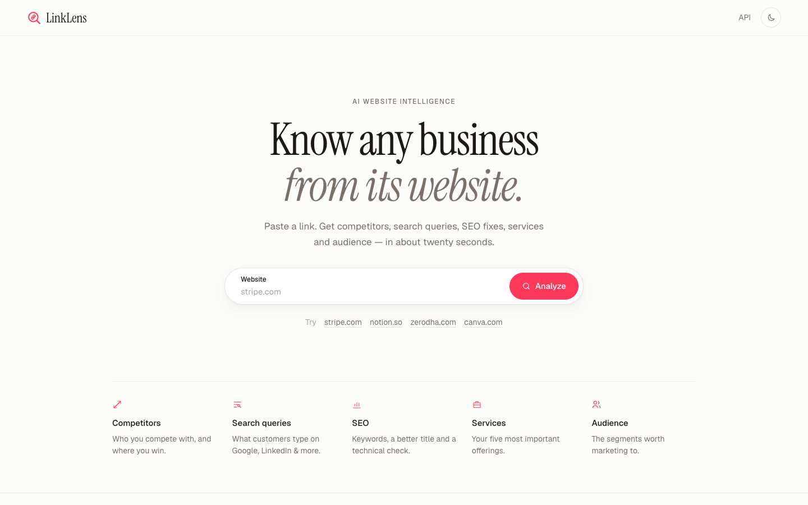

*Minimal, editorial UI: Instrument Serif display type, Geist for text, light and dark themes, and skeleton loading states that mirror the final layout.*

---

## Contents

1. [What it does](#1-what-it-does)
2. [Use it in 30 seconds (no setup)](#2-use-it-in-30-seconds-no-setup)
3. [Run it yourself](#3-run-it-yourself)
4. [API usage](#4-api-usage)
5. [How it works](#5-how-it-works)
6. [LLM research and model recommendation](#6-llm-research-and-model-recommendation)
7. [Security](#7-security)
8. [Configuration](#8-configuration)
9. [Project structure](#9-project-structure)
10. [Testing and quality](#10-testing-and-quality)
11. [Deployment](#11-deployment)
12. [Screenshots](#12-screenshots)
13. [Known limitations](#13-known-limitations)

More detail lives in [`docs/`](docs): [User guide](docs/USER_GUIDE.md) · [API reference](docs/API.md) · [Architecture](docs/ARCHITECTURE.md) · [LLM research](docs/LLM_RESEARCH.md) · [Deployment](docs/DEPLOYMENT.md)

---

## 1. What it does

You give it a URL. It reads the real website (homepage plus up to 3 key pages such as *About*, *Services* and *Products*), sends the cleaned text to Google Gemini, and returns five sections:

| # | Section | What you get |
|---|---|---|
| 1 | **Competitor vs your brand** | Brand overview, category, products, 3–5 competitors with strengths and weaknesses, your advantages, positioning opportunities |
| 2 | **Top 5 search queries** | Real-sounding queries mapped to Google, Facebook, Instagram, LinkedIn and X, with intent, relevance and audience |
| 3 | **SEO improvements** | Primary, secondary, long-tail and business keywords; a new title and meta description beside the current ones; an 11-point **technical SEO check measured from the HTML**; content ideas |
| 4 | **Top 5 services** | Name, description, industry, customer and benefit, each **labelled `website` (found on the site) or `inferred`** |
| 5 | **Target audience** | Primary and secondary audiences, industries, business types, profiles, location, needs, challenges, interests, marketing segments |

The analysis follows the assignment's integrity rules:

- **Search volumes are never invented.** The schema has no volume field at all, and every response states `"search_volume": "not_provided"` with the reason.
- **Competitors are labelled.** Each one carries `source: "ai_suggested"`, or `"web_grounded"` with source links when live Google Search grounding is switched on.
- **Analysis is based on the actual site content.** The prompt forbids inventing facts about the business and treats the website text as untrusted data, which protects against prompt injection.

---

## 2. Use it in 30 seconds (no setup)

1. Open **https://link-analysis.lunarnodes.co.in**
2. Type or paste a website, for example `stripe.com` (the `https://` part is optional).
3. Press **Analyze**. A live progress card shows the real percentage and what is happening right now (fetching pages, researching competitors, refining…). It usually finishes in 15–30 seconds.
4. Switch between the tabs: **Competitors · Search queries · SEO · Top services · Audience · JSON**.
5. Use **Copy** on any recommended title or description, or **Download** the full JSON.

Tips:
- The address bar link is shareable. `…/?url=stripe.com#seo` opens straight to the SEO tab.
- A site that was analyzed recently loads instantly from the 24-hour cache, with no AI cost.
- The moon and sun button switches between dark and light mode.

A step-by-step guide with pictures is in **[docs/USER_GUIDE.md](docs/USER_GUIDE.md)**.

---

## 3. Run it yourself

LinkLens is open source. If the public demo's shared AI quota is used up (you'll see a clear *"shared AI quota is used up"* message), you can run your own copy in a few minutes.

You need a free **Gemini API key** from https://aistudio.google.com/apikey. It takes a Google account and about a minute, and no card is required for the free tier.

### Option A: Docker (recommended, one command)

Requires [Docker Desktop](https://www.docker.com/products/docker-desktop/).

```bash
git clone https://github.com/kharetanishk/ai-link-analysis.git
cd ai-link-analysis
cp .env.example .env          # then open .env and paste your key after GEMINI_API_KEY=
docker compose up -d --build
```

Open **http://localhost:4000** (app) and **http://localhost:4000/docs** (API docs).
Stop it with `docker compose down`.

### Option B: Local development (hot reload)

Requires Python 3.12+ and Node 20+.

```bash
cp .env.example .env          # add GEMINI_API_KEY
make install                  # creates apps/api/.venv and installs the web packages
make dev-api                  # API on http://localhost:4000  (same as: uvicorn app.main:app --host 0.0.0.0 --port 4000)
make dev-web                  # in a second terminal: UI on http://localhost:5173
```

Run `make help` to list every command (`test`, `format`, `build`, `up`, `down`, `logs`).

---

## 4. API usage

### Request

```http
POST /link-analysis
Content-Type: application/json

{ "url": "https://example.com" }
```

```bash
curl -X POST https://link-analysis.lunarnodes.co.in/link-analysis \
  -H "Content-Type: application/json" \
  -d '{"url": "stripe.com"}'
```

```python
import httpx
report = httpx.post("https://link-analysis.lunarnodes.co.in/link-analysis",
                    json={"url": "stripe.com"}, timeout=120).json()
print(report["brand"]["name"], [c["name"] for c in report["analysis"]["competitor_analysis"]["competitors"]])
```

### Response (shortened; real full response: [`docs/examples/stripe.com.json`](docs/examples/stripe.com.json))

```json
{
  "success": true,
  "website": "https://stripe.com/in",
  "brand": {
    "name": "Stripe",
    "category": "Financial Infrastructure & Payment Processing",
    "summary": "Stripe is a comprehensive financial technology platform providing programmable infrastructure for online and in-person commerce..."
  },
  "analysis": {
    "competitor_analysis": {
      "brand_overview": "...",
      "competitors": [
        { "name": "Razorpay", "website": "https://razorpay.com", "main_service": "Payment Gateway and Business Banking",
          "target_market": "Indian businesses and startups", "strengths": ["..."], "weaknesses": ["..."],
          "source": "ai_suggested", "source_urls": [] }
      ],
      "strengths": ["..."],
      "opportunities": ["..."],
      "disclaimer": "Competitors are AI-generated suggestions..."
    },
    "target_search_queries": [
      { "query": "Best payment gateway for SaaS subscription management", "platforms": ["Google"],
        "intent": "Researching tools for recurring billing", "business_relevance": "...", "target_audience": "SaaS Founders" }
    ],
    "search_queries_note": { "search_volume": "not_provided", "reason": "No keyword or social search-volume data source is connected..." },
    "seo_improvements": {
      "primary_keyword": "financial infrastructure",
      "secondary_keywords": ["..."], "long_tail_keywords": ["..."], "business_keywords": ["..."],
      "current_title": "Stripe | Financial Infrastructure to Grow Your Revenue",
      "recommended_title": "Financial Infrastructure & Online Payments Platform | Stripe",
      "meta_description": "...",
      "technical_audit": [ { "check": "H1 heading", "status": "warn", "finding": "2 H1 tag(s) found", "recommendation": "Use exactly one descriptive H1 per page." } ],
      "supporting_content": [ { "type": "faq", "title": "Stripe Pricing and Fees FAQ", "purpose": "..." } ]
    },
    "top_services": [ { "name": "Payments", "description": "...", "target_industry": "E-commerce and Retail",
                        "target_customer": "Online merchants", "main_benefit": "...", "source": "website" } ],
    "target_audience": { "primary_audience": ["..."], "geographic_focus": "Global, with India localization", "recommended_segments": ["..."] }
  },
  "meta": {
    "model": "gemini-3.1-flash-lite", "cached": false, "latency_ms": 18863,
    "tokens": { "input": 8718, "output": 2938, "thinking": 3103 },
    "estimated_cost_usd": 0.011241,
    "pages_analyzed": ["https://stripe.com/in", "https://stripe.com/in/about", "https://stripe.com/in/products", "https://stripe.com/in/professional-services"],
    "warnings": [], "analyzed_at": "2026-11-18T18:23:31Z"
  }
}
```

### Errors

Every error has the same shape, so clients only need one parser:

```json
{ "success": false, "error": { "code": "blocked_url", "message": "This address points to a private or internal network and cannot be analyzed.", "request_id": "f8e53bc2..." } }
```

| HTTP | `code` | When |
|---|---|---|
| 422 | `invalid_request` | Body is not `{"url": "..."}` |
| 422 | `invalid_url` | Not a valid http(s) address, or the domain does not exist |
| 400 | `blocked_url` | Private, internal or cloud-metadata address, or a non-standard port |
| 415 | `unsupported_content` | Link is a PDF, image or other non-HTML file |
| 422 | `insufficient_content` | Page has almost no readable text |
| 502 | `site_unreachable` / `site_access_denied` | Site is down, returns 4xx/5xx, or blocks bots |
| 504 | `site_timeout` | Site too slow |
| 429 | `rate_limited` | Too many requests (`Retry-After` header included) |
| 502 | `llm_invalid_output` | AI returned malformed output, even after retry and fallback |
| 503 | `llm_unavailable` / `llm_not_configured` | AI provider down or busy, or no API key on the server |
| 503 | `ai_quota_exhausted` | The demo's shared AI quota is used up. `details.self_host_guide` links to [Run it yourself](#3-run-it-yourself) with your own free key. |

### Live progress (Server-Sent Events)

`POST /link-analysis/stream` takes the same body and streams `progress` events (`stage`, `percent`, `message`), then one `result` (the full report) or `error` event. The web UI uses this to show real progress instead of a blank wait.

```bash
curl -N -X POST https://link-analysis.lunarnodes.co.in/link-analysis/stream \
  -H "Content-Type: application/json" -d '{"url": "bluetokaicoffee.com"}'
```

```text
event: progress
data: {"stage":"fetching","percent":8,"message":"Fetching bluetokaicoffee.com"}
...
event: progress
data: {"stage":"extracted","percent":34,"message":"Read 4 pages · 1,861 words of content"}
event: progress
data: {"stage":"market_ready","percent":65,"message":"Competitors & search queries ready"}
...
event: result
data: {"success":true, ...full report...}
```

Full field-by-field reference: **[docs/API.md](docs/API.md)**.

---

## 5. How it works

```mermaid
flowchart LR
    A[POST /link-analysis] --> B[Validate & normalize URL]
    B --> C{Cache hit?}
    C -- yes --> R[Return cached report]
    C -- no --> D[SSRF check: resolve DNS,<br/>block private IPs]
    D --> E[Fetch homepage<br/>pinned IP, 2 MB cap,<br/>re-check every redirect]
    E --> F[Extract: title, meta, OG, JSON-LD,<br/>headings, nav, main text]
    F --> G[Fetch up to 3 key sub-pages<br/>about / services / products]
    G --> H[Clean, dedupe, trim to token budget]
    H --> I1[Gemini call A<br/>brand + competitors + queries]
    H --> I2[Gemini call B<br/>SEO + services + audience]
    I1 & I2 --> J[Validate JSON against Pydantic schema<br/>retry once, then fallback model]
    J --> K[Post-process: drop self/duplicate competitors,<br/>label sources, add measured SEO audit]
    K --> L[Cache 24h + return JSON]
```

The key engineering decisions:

| Decision | Why |
|---|---|
| **Two parallel LLM calls** instead of one big call | Roughly halves response time. It costs about $0.001 extra input per analysis and keeps each call under the Cloudflare 100s limit. |
| **Native structured output** (JSON schema enforced by Gemini) **plus** Pydantic validation | The provider guarantees the JSON shape and the app still checks types, counts and enums before trusting it. |
| **Retry once, then fallback model** | A malformed response is retried on the same model. An outage or 429 switches to the fallback model. |
| **Deterministic technical SEO audit** | Title length, H1 count, canonical, alt text and similar are measured from the HTML, not guessed by the AI. That makes them accurate and free. |
| **Content budget** (~24k characters, about 6k tokens) | Website noise (scripts, nav, duplicates) is stripped first, so the model only sees useful text. |
| **In-memory cache with request coalescing** | Re-analyzing the same URL within 24h is free and instant. Ten simultaneous requests for one URL make one AI call. |

More detail, including the sequence of every check: **[docs/ARCHITECTURE.md](docs/ARCHITECTURE.md)**.

---

## 6. LLM research and model recommendation

> Full comparison, methodology and raw benchmark data: **[docs/LLM_RESEARCH.md](docs/LLM_RESEARCH.md)**.

**Recommended: Google Gemini `gemini-3.1-flash-lite`**, with `gemini-3.5-flash-lite` as the fallback.

| | Value | Type |
|---|---|---|
| Price | $0.25 / 1M input · $1.50 / 1M output | Official pricing, Nov 2026 |
| Input tokens per analysis | ~7,200 average (2 calls; 8,700 for a large site like Stripe) | **Measured** |
| Output tokens per analysis (incl. thinking) | ~4,900 average | **Measured** |
| **Cost per website analysis** | **≈ $0.009 average** ($0.008–0.011) | **Measured** across 5 sites |
| Response time | Median 15.7s across 5 sites (13–19s on live requests); slower at peak | **Measured** (see benchmark) |
| Context window | 1M tokens | Official docs |
| Structured JSON | Native JSON-schema output | Official docs, verified in production |

The reasons for this choice are summarized below; the full side-by-side table is in the research doc.

- It was the **fastest model measured**: median 15.7s, versus 44.7s for `gemini-3.5-flash-lite`. `gemini-3.8-flash` timed out on all 5 sites.
- It is the **cheapest Gemini model that kept quality**: correct brand, real competitors, and SEO lengths within range.
- Native JSON-schema output produced **zero schema-validation failures** across all benchmark and live runs. Every failure was a provider timeout, which the fallback model absorbs.
- A 1M-token context means even very large sites never need chunking.
- Same provider and API key for the fallback, so there is no extra integration.

**Alternatives considered** (pricing from official pages, Nov 2026; **not benchmarked** because only a Gemini key was available):

| Provider | Model | Input / Output per 1M | Est. cost per analysis* |
|---|---|---|---|
| Google | gemini-3.1-flash-lite | $0.25 / $1.50 | **$0.0092 (measured)** |
| Google | gemini-3.5-flash-lite | $0.30 / $2.50 | **$0.0087 (measured)**, but 3× slower |
| Google | gemini-3.8-flash | $0.75 / $3.75 | ~$0.024 (estimate; timed out in benchmark) |
| Anthropic | claude-haiku-5-5 | $0.10 / $0.50 | ~$0.003 (estimate) |
| OpenAI | gpt-5-mini | $0.25 / $2.00 | ~$0.012 (estimate) |
| DeepSeek | deepseek-flash | $0.15–0.30 / $0.60–1.20 | ~$0.004–0.008 (estimate) |

\*Estimates use the measured token profile (~7.2k input, ~4.9k output) multiplied by list price. Real token counts differ by tokenizer.

**Cost optimizations already built in:** HTML noise removal and deduplication, a content budget, list-size caps to limit output tokens, a 24h cache with request coalescing (repeat URLs cost $0), a deterministic SEO audit (no tokens), a single provider round-trip per section group, and `store: false`. Further levers (lower thinking level, batch mode, prompt caching) are covered in the research doc.

---

## 7. Security

| Threat | Protection |
|---|---|
| **SSRF** (making the server fetch internal URLs) | Only `http`/`https` on ports 80/443. No embedded credentials. `localhost`, `*.local` and `*.internal` are blocked. DNS is resolved and **every** returned IP must be public: private, loopback, link-local, CGNAT, multicast, reserved and IPv4-mapped IPv6 are all blocked. |
| **DNS rebinding** | The connection goes to the **already-validated IP**, with the original hostname sent in the `Host` header and TLS SNI, so certificates are still verified. |
| **Redirect to internal host** | Redirects are followed manually, at most 5, and **each hop is re-validated**. |
| **Huge or binary responses** | The body is streamed and capped at 2 MB, non-HTML is rejected, and timeouts apply to every request. |
| **Prompt injection from website text** | Content is wrapped as untrusted data and the system prompt tells the model to ignore any instructions inside it. Output must match a strict schema. |
| **Secrets** | The API key lives only in `.env` (git-ignored, `chmod 600`). It is loaded as a `SecretStr`, never logged and never returned in responses. |
| **Rate limiting** | Per-IP limits at both the nginx and app layers, a cap on concurrent AI calls, and a cache that serves repeat URLs without new AI calls. |
| **Web app hardening** | CSP, `X-Frame-Options: DENY`, `nosniff`, a strict referrer policy and a 16 KB request body limit. Errors never leak stack traces. |
| **Container hardening** | Non-root user, read-only filesystem, all Linux capabilities dropped, `no-new-privileges`, memory and CPU limits, bound to `127.0.0.1` behind nginx with HTTPS. |

---

## 8. Configuration

All settings are environment variables in `.env` (see [`.env.example`](.env.example)). Only `GEMINI_API_KEY` is required.

| Variable | Default | Meaning |
|---|---|---|
| `GEMINI_API_KEY` | *(required)* | Google AI Studio key |
| `GEMINI_MODEL` | `gemini-3.1-flash-lite` | Primary model |
| `GEMINI_FALLBACK_MODEL` | `gemini-3.5-flash-lite` | Used if the primary fails |
| `GEMINI_THINKING_LEVEL` | `low` | `minimal` / `low` / `medium` / `high` |
| `ENABLE_SEARCH_GROUNDING` | `false` | `true` makes competitor research use live Google Search (more accurate, adds about $0.04–0.07 per analysis after the free quota) |
| `LLM_TIMEOUT_SECONDS` | `40` | Per AI call |
| `PRICE_INPUT_PER_MILLION` / `PRICE_OUTPUT_PER_MILLION` | `0.25` / `1.50` | Used for `meta.estimated_cost_usd` |
| `RATE_LIMIT_REQUESTS` / `RATE_LIMIT_WINDOW_SECONDS` | `10` / `60` | Per-IP limit |
| `CACHE_TTL_SECONDS` | `86400` | Cache lifetime (24h) |
| `FETCH_EXTRA_PAGES` | `3` | Sub-pages read in addition to the homepage |
| `CONTENT_CHAR_BUDGET` | `24000` | Max characters of site text sent to the AI |
| `HOST_PORT` | `4000` | Port Docker exposes on `127.0.0.1` |

---

## 9. Project structure

```text
ai-link-analysis/                 monorepo
├── apps/
│   ├── api/                      FastAPI backend (Python 3.12)
│   │   ├── app/
│   │   │   ├── main.py           app factory, middleware, routes, static UI
│   │   │   ├── config.py         typed settings from env
│   │   │   ├── schemas.py        request/response + LLM output contracts (Pydantic)
│   │   │   ├── errors.py         error types + one JSON error envelope
│   │   │   ├── services/
│   │   │   │   ├── website_extractor.py   safe fetch + HTML extraction
│   │   │   │   ├── llm_service.py         Gemini structured calls, retry, fallback
│   │   │   │   ├── analysis_service.py    orchestration, prompt, SEO audit
│   │   │   │   └── competitor_service.py  dedupe + source labelling
│   │   │   └── utils/
│   │   │       ├── validators.py  URL normalization + SSRF protection
│   │   │       └── cache.py       TTL cache, request coalescing, rate limiter
│   │   ├── scripts/benchmark.py  reproducible LLM benchmark
│   │   └── tests/                pytest suite (80 tests)
│   └── web/                      React + Vite + TypeScript UI (self-hosted fonts, no UI framework)
├── deploy/                       nginx template + one-command server deploy
├── docs/                         guides, research, screenshots, sample responses
├── Dockerfile                    multi-stage: build UI, then slim Python runtime
├── docker-compose.yml            hardened runtime config
├── Makefile                      every common command
└── .github/workflows/ci.yml      lint, tests, UI build, Docker build
```

---

## 10. Testing and quality

```bash
make test
```

- **80 automated tests**. No network or API key is needed: a fake website and a fake LLM are used.
  - **SSRF:** loopback, private ranges, metadata IP, IPv6, IPv4-mapped, CGNAT, mixed DNS answers, redirect to an internal host, redirect loops, odd ports, credentials in the URL.
  - **Extraction:** metadata, JSON-LD, dedupe, sub-page discovery, size cap, timeouts, status-code mapping, JS-rendered sites.
  - **LLM:** parallel parts, invalid-JSON retry, fallback on 429/5xx, no retry on auth errors, schema consistency (the regression test for a real bug found in production).
  - **API contract:** the five sections, exactly 5 queries, no search volumes, competitor self-removal, caching, rate limiting, the error envelope.
- `ruff` lint and format checks, and TypeScript strict mode.
- **CI** (GitHub Actions) runs all of it plus the Docker build on every push.

---

## 11. Deployment

Production runs on an Ubuntu VM: **Cloudflare → nginx (HTTPS, Let's Encrypt, rate limit, real client IP) → Docker container on 127.0.0.1:4200**.

Deploy or redeploy with one command on the server:

```bash
cd /opt/ai-link-analysis && git pull && sudo DOMAIN=link-analysis.lunarnodes.co.in bash deploy/deploy.sh
```

Step-by-step guide, including other hosts (Render, Railway, Fly.io): **[docs/DEPLOYMENT.md](docs/DEPLOYMENT.md)**.

---

## 12. Screenshots

| Loading (skeleton) | Competitors |
|---|---|
| 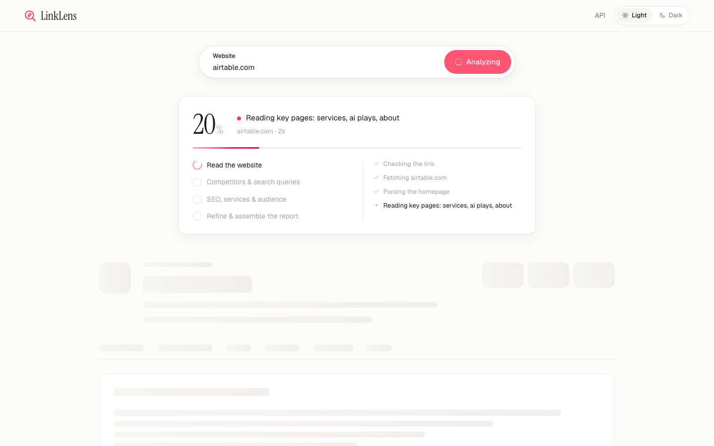 | 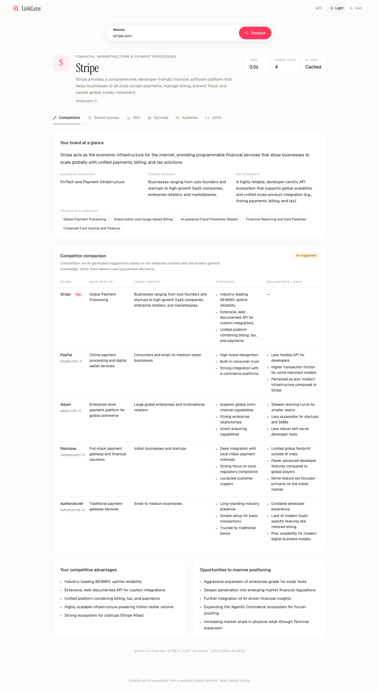 |
| **Search queries** | **JSON** |
| 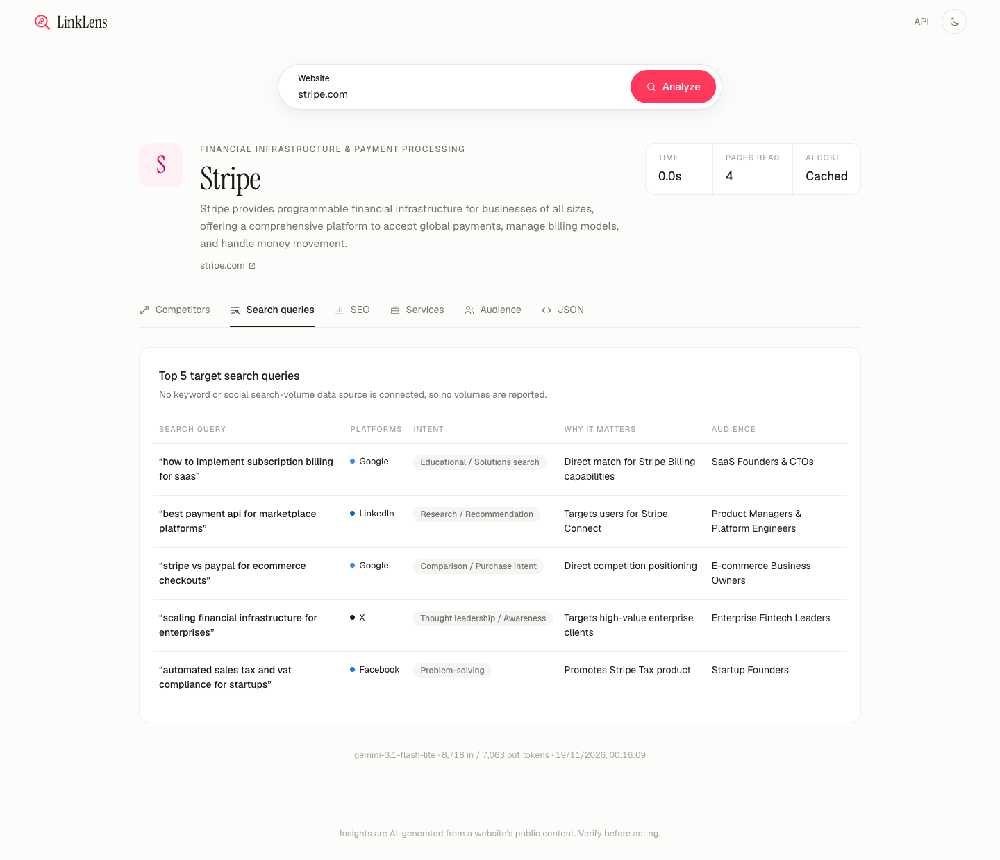 | 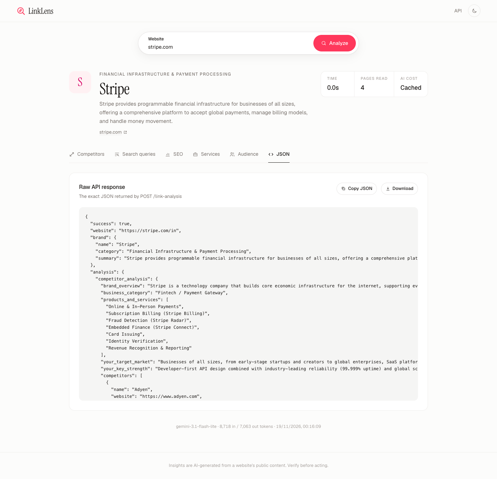 |
| **SEO** | **Top services** |
| 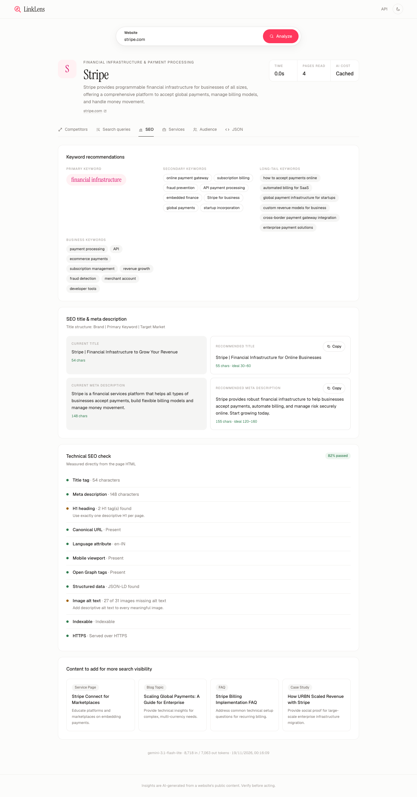 | 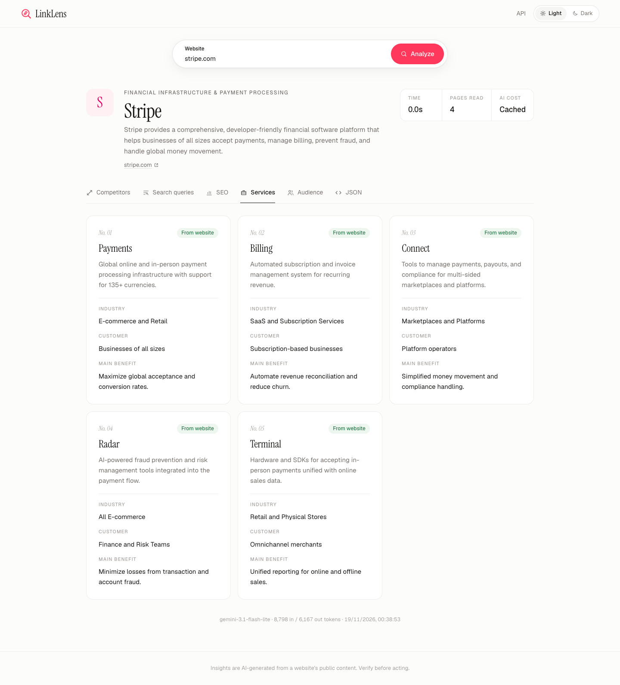 |
| **Audience** | **Dark mode** |
| 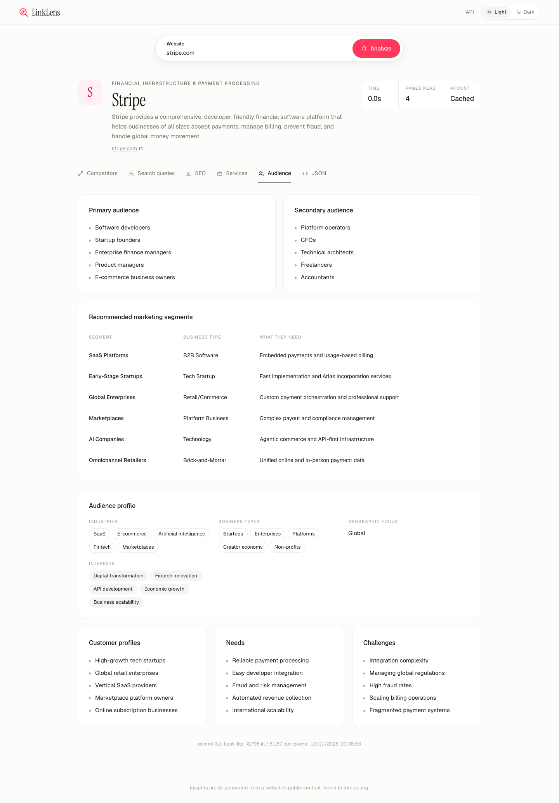 | 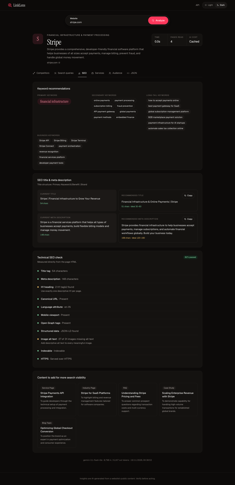 |
| **Friendly errors** | **Mobile** |
| 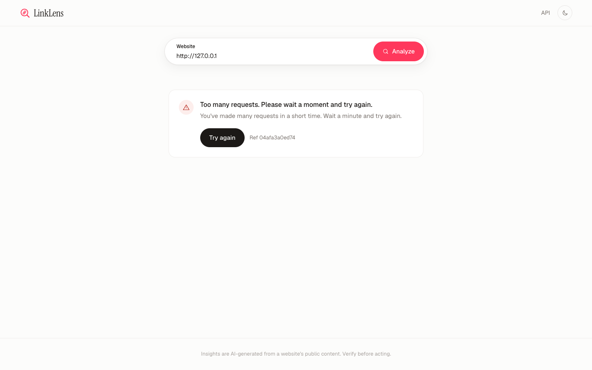 | 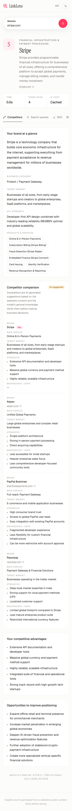 |

API documentation (Swagger UI at `/docs`):

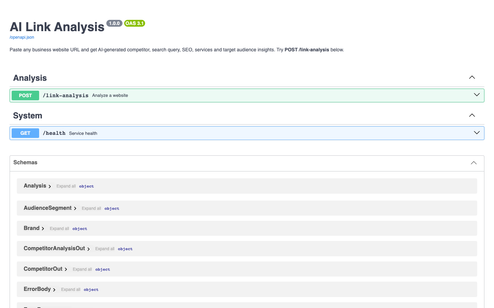

---

## 13. Known limitations

- **JavaScript-only sites** (content rendered entirely in the browser) expose little HTML. The API still analyzes their metadata and sub-pages, and returns a warning.
- **Bot-protected sites** (Cloudflare challenges, login walls) return `site_access_denied`, by design. Bypassing protections is out of scope.
- **Competitors** come from the model's knowledge unless `ENABLE_SEARCH_GROUNDING=true`. They are always labelled.
- **Latency** depends on Gemini's load: 10–20s is typical, and peak times can be slower. A paid tier with `service_tier: "priority"` reduces that variance.
- The cache and rate limiter are in-memory, which is fine for a single server. Use Redis for multiple replicas.

---

Built by **Tanishk Khare** for the Dxora Technologies Python practical test.
