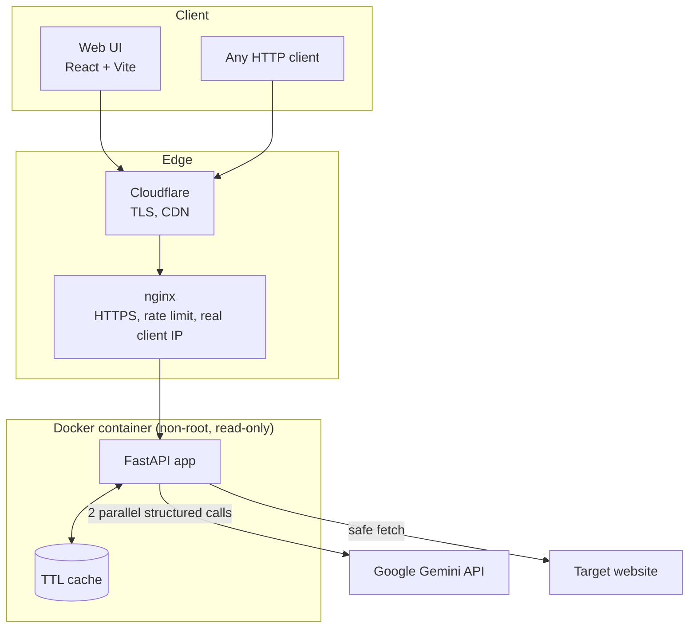
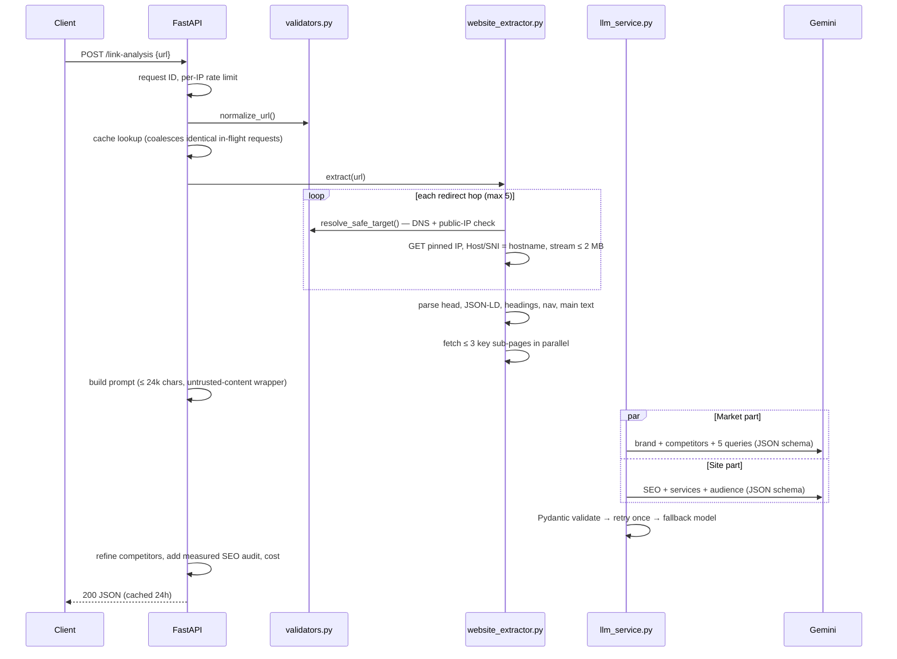

# Architecture

## Overview

The UI is built into static files and served by the same FastAPI process. That gives one container, one origin, and no CORS to configure.

## Request lifecycle

## Modules

| File | Responsibility |
|---|---|
| `app/main.py` | App factory and lifespan: one shared `httpx.AsyncClient`. Middleware for request ID, security headers, access log and GZip. Routes. Static UI mount. |
| `app/config.py` | All settings from environment variables, typed with `pydantic-settings`. Secrets are held as `SecretStr`. |
| `app/schemas.py` | The **contract**: the request model, the LLM output models (`MarketAnalysis`, `SiteAnalysis`, merged into `LLMAnalysis`) and the API response models. The same models generate the Gemini JSON schema and validate its output. |
| `app/errors.py` | Typed exceptions mapped to HTTP status codes, plus one JSON error envelope for every failure, including validation and unexpected errors. |
| `app/utils/validators.py` | URL normalization (IDNA, default scheme, ports) and SSRF protection (DNS resolution, public-IP-only rule). |
| `app/services/website_extractor.py` | IP-pinned fetching, manual redirect handling, size cap, content-type checks, and HTML to structured content. |
| `app/services/llm_service.py` | Gemini Interactions API, schema flattening, parallel parts, retry and fallback, token usage and cost. |
| `app/services/analysis_service.py` | Orchestration, the system prompt, prompt building within the token budget, and the deterministic SEO audit. |
| `app/services/competitor_service.py` | Removes the brand itself and duplicates, cleans URLs, labels sources (`ai_suggested` / `web_grounded`) and matches citations. |
| `app/utils/cache.py` | LRU+TTL cache with in-flight request coalescing, and a sliding-window rate limiter. |

## Design decisions

| Decision | Alternatives considered | Why this one |
|---|---|---|
| **Gemini native JSON schema + Pydantic validation** | Free-text JSON with regex repair; function calling | Provider-side schema enforcement removes almost all parse failures. Pydantic still guards types, counts and enums. |
| **Two parallel calls** | One large call; five calls (one per section) | One call was 2–3× slower. Five calls would repeat the website input five times. Two balances speed against input cost. |
| **Schemas generated from Pydantic** | Hand-written JSON schema | One source of truth. `$ref`s are inlined because Gemini needs a flat schema. |
| **Deterministic SEO audit** | Ask the LLM to audit SEO | Facts such as "2 H1 tags" or "27 of 31 images missing alt" must be exact, and computing them is free. |
| **IP-pinned HTTP fetch** | Plain `httpx.get(url, follow_redirects=True)` | The plain approach is open to DNS rebinding and redirect-based SSRF. |
| **BeautifulSoup + lxml** | Headless browser (Playwright) | 10–50× lighter and faster. A browser would add a large attack surface and memory cost. JS-only sites get a clear warning instead. |
| **In-memory cache and limiter** | Redis | Single instance, no extra service to run. Swapping in Redis is straightforward when scaling horizontally. |
| **UI served by FastAPI** | Separate frontend host | One deploy, one domain, same-origin API calls (strict CSP, no CORS). |
| **React + plain CSS, self-hosted fonts** | UI framework / CSS library, Google Fonts | Small bundle (~75 KB gzipped JS), full control of the visual style, and no third-party requests (strict CSP). |

## Prompt design

- A **system prompt** sets the role and eight explicit rules: ground facts in the content, label inferred services, name only real competitors, use exactly 5 queries across the requested platforms, never output numeric metrics, respect SEO length targets, stay specific, and treat website text as untrusted.
- The **user prompt** is a compact fact sheet (title, meta, Open Graph, JSON-LD organization, H1/H2/H3, navigation) followed by budgeted page text inside `<website_content>` tags.
- Each part receives a one-line instruction naming only the fields it must return, and its JSON schema enforces the same.

## Failure handling

| Failure | Behaviour |
|---|---|
| Target site down, slow, blocked or non-HTML | Specific error code and a friendly message; no AI call is made |
| Sub-page fails | Skipped silently; the analysis continues with the pages that worked |
| JS-rendered homepage | Continues with metadata and sub-pages, and adds a warning |
| LLM returns invalid JSON | Retry once on the same model, then the fallback model |
| LLM timeout, 429 or 5xx | Switch to the fallback model immediately |
| LLM auth error | Fail fast with `llm_not_configured` (never retried) |
| One of the two parts fails | Whole request fails cleanly; partial data is never returned |
| Unexpected exception | Logged with request ID; client gets a generic `internal_error` |
