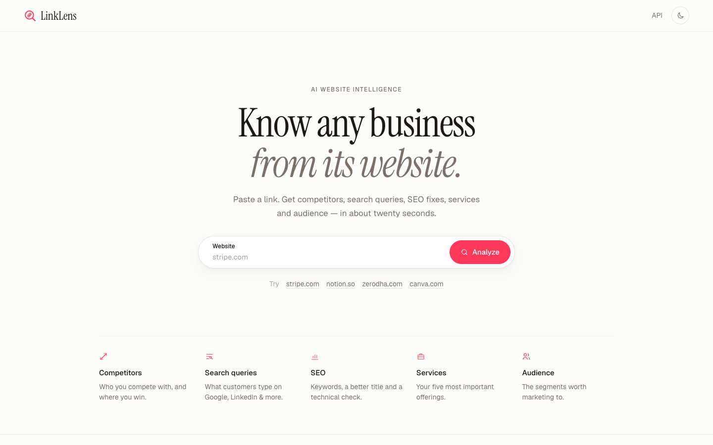
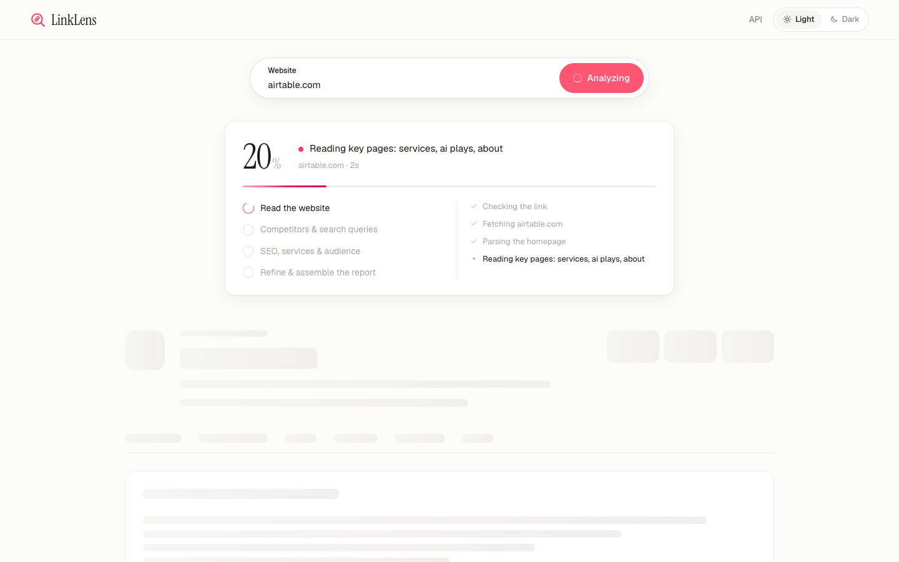
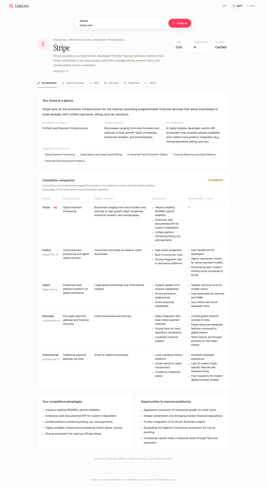
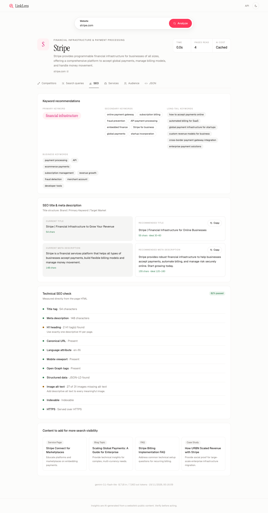
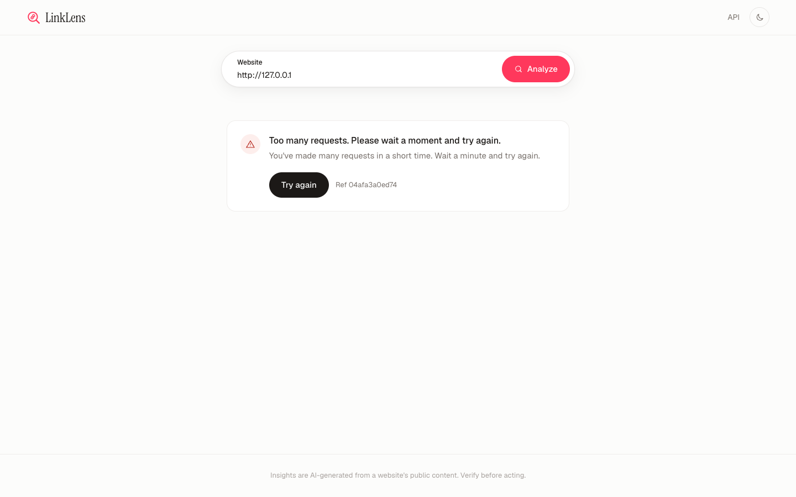

# User Guide

This guide is for anyone: marketers, founders, sales teams, students. No technical knowledge is needed.

---

## What LinkLens does

You paste the address of any business website. In about 15–30 seconds LinkLens reads that website and gives you a report with five parts:

1. **Competitors**: who the business competes with, their strengths and weaknesses, and where the business can do better.
2. **Search queries**: five things potential customers would type into Google, Facebook, Instagram, LinkedIn or X to find this kind of business.
3. **SEO**: keywords to target, a better page title and description (ready to copy), a health check of the website, and ideas for new pages or blog posts.
4. **Top services**: the five most important things the business sells.
5. **Audience**: who the customers are, what they need, and which groups to target in marketing.

---

## Step by step

### 1. Open the app

Go to **https://link-analysis.lunarnodes.co.in**

### 2. Type a website

Click the **Website** box and type or paste an address. Any of these work:

- `stripe.com`
- `www.stripe.com`
- `https://stripe.com/about`

You don't need to type `https://`.

Not sure what to try? Click one of the examples under the box (**stripe.com**, **notion.so**…).

### 3. Press Analyze

While the report is being prepared you'll see a live progress card:

- a **percentage** that moves as real work completes,
- **what is happening right now** (for example "Fetching hubspot.com", "Reading key pages: about, pricing", "Cross-referencing competitors…"),
- a **checklist** of the four big steps, ticked off as each finishes,

with grey placeholder blocks in the shape of the final report underneath.

This usually takes **15–30 seconds**. If someone analyzed the same website in the last 24 hours, the report appears instantly.

### 4. Read the report

At the top you'll see the business name, its category, a short summary, and three small numbers:

| Number | Meaning |
|---|---|
| **Time** | How long the report took |
| **Pages read** | How many pages of the website were read (homepage + up to 3 more) |
| **AI cost** | What the AI part of this report cost, or "Cached" if it was free |

Below that are six tabs. Click any tab, or use the ← → arrow keys.

| Tab | What you'll find | Good for |
|---|---|---|
| **Competitors** | A comparison table: you vs 3–5 competitors | Sales pitches, strategy meetings |
| **Search queries** | 5 queries with the platform where each fits | Ad campaigns, social posts |
| **SEO** | Keywords, current vs recommended title and description, a website health check, content ideas | Website improvements |
| **Services** | 5 service cards. "From website" means it is written on the site; "Inferred" means the AI suggested it | Understanding the offer |
| **Audience** | Target groups, industries, needs, challenges | Marketing plans |
| **JSON** | The raw data, with **Copy JSON** and **Download** buttons | Sharing with developers, saving the report |

### 5. Copy, share or save

- **Copy** buttons appear next to the recommended title and description. Paste them straight into your website editor.
- **Share**: the address bar link opens the same report. Adding `#seo`, `#services` and so on opens a specific tab. Example: `https://link-analysis.lunarnodes.co.in/?url=stripe.com#seo`
- **Save**: go to the **JSON** tab and click **Download**.

### 6. Light and dark mode

Use the **Light / Dark** switch in the top-right corner. Your choice is remembered.

---

## Understanding the labels

| Label | Meaning |
|---|---|
| **AI-suggested** (competitors) | The AI named these competitors from the website's content and its general knowledge. Double-check before important decisions. |
| **Web-grounded** (competitors) | The competitors were researched with a live Google search, and source links are shown. |
| **From website** (services) | This service is actually mentioned on the website. |
| **Inferred** (services) | Not stated directly; the AI thinks it is likely. |
| 🟢 / 🟡 / 🔴 (SEO check) | Pass / could be better / needs fixing. These are measured from the website's code, not guessed. |
| "No volumes are reported" | LinkLens never invents search-volume numbers. That data needs a paid keyword tool. |

---

## If something goes wrong

LinkLens explains every problem in plain words, with a tip and a **Try again** button.

| Message | What to do |
|---|---|
| "Please enter a valid website address" | Check for typos. Use the format `example.com`. |
| "This domain does not exist" | The address is wrong or the website no longer exists. |
| "This address points to a private or internal network" | Only public websites can be analyzed. |
| "This website refused automated access" | Some sites block tools like this. Try another page of the site, or a different site. |
| "We could not reach this website" | Open the link in your browser. If it doesn't load there either, the site is down. |
| "The page has too little readable text" | Try a more specific page, such as `/about` or `/services`. |
| "Too many requests" | Wait one minute and try again. |
| "The AI service is busy" | Wait a minute and try again. |
| "The shared AI quota for this demo is used up" | The free demo has reached its AI limit for now. Click **Run it yourself** for the 3-step setup, and **Get a free Gemini key** to create your own key. |

---

## Tips for the best results

- Use the **main website** of a business (`company.com`) rather than a social media profile.
- For large companies with many products, try a specific product page for a more focused report.
- Websites that load almost all their content with JavaScript give shorter reports. LinkLens shows a notice when that happens.
- Treat AI output as a **smart first draft**. Verify competitor details before using them in important decisions.
